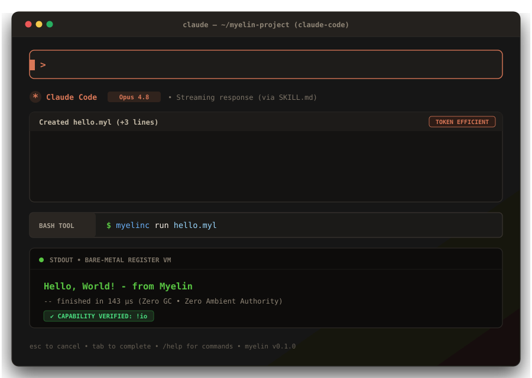

<div align="center">

# Myelin (`.myl`)

**The Universal, Token-Minimal, Capability-Safe Systems Programming Language for the Autonomous AI Era.**

[](https://github.com/muscankaraoglu/myelin-lang/actions)
[](./LICENSE)
[](https://github.com/muscankaraoglu/myelin-lang/releases)
[](https://muscankaraoglu.github.io/myelin-lang/)

<br />

<p align="center">
  
</p>

[English](./README.md) • [Türkçe Dokümantasyon](./README.tr.md) • [Official Documentation Hub (Wiki)](./wiki/) • [LLM Skill Spec (SKILL.md)](./SKILL.md)

</div>

---

## ⚡ The Vision

In neurobiology, **myelin** wraps nerve axons to eliminate signal leakage and accelerate impulses by 100x. In software engineering, **Myelin** eliminates decades of human-ergonomic ceremony between neural reasoning and machine execution.

Mainstream languages (C#, TypeScript, Python, Rust) were engineered around human biological constraints: 60-WPM keyboards, visual brace matching, `async/await` coloring, and verbose compiler prose.

When autonomous coding agents write software, those human affordances become liabilities:
1. **55–65% Output Token Waste:** Boilerplate keywords, nested closing braces, and repetitive type wrappers exhaust context windows and inflate autoregressive latency.
2. **Implicit Side-Effect Bugs:** `null`, unchecked exceptions, and ambient OS authority allow subtle bugs to hide inside thousands of lines of generated code.
3. **The Human Review Bottleneck:** If humans stop writing code, how do humans *trust* running it?

**Myelin flips the contract:**
- **LLMs read [`SKILL.md`](./SKILL.md)** (~900 tokens) and emit canonical, brace-free **Flat Line-SSA** with single-line compiler repair feedback (`myelinc check --llm`).
- **Machines compile `.myl`** in microseconds into a standalone binary or register VM using **Perceus compile-time reference counting** (zero GC pauses, zero Rust lifetime battles).
- **Humans run `myelinc audit`** and inspect a mathematically verified **Trust & Capability Manifest** (`!fs`, `!net`, `!db`, `req`/`ens` contracts, SHA-256 fingerprint) instead of reading source code.

---

## 🚀 Quick Start (Under 60 Seconds)

### 1. Download Standalone Compiler (`myelinc`)

Pre-built binaries with **zero runtime dependencies** are available for all major platforms on [GitHub Releases](https://github.com/muscankaraoglu/myelin-lang/releases):

| Operating System | Architecture | Binary Package |
| :--- | :--- | :--- |
| **Windows** | x86_64 | [`myelinc-windows-x86_64.zip`](https://github.com/muscankaraoglu/myelin-lang/releases) |
| **Linux** | x86_64 | [`myelinc-linux-x86_64.tar.gz`](https://github.com/muscankaraoglu/myelin-lang/releases) |
| **Linux (ARM64)** | aarch64 | [`myelinc-linux-arm64.tar.gz`](https://github.com/muscankaraoglu/myelin-lang/releases) |
| **macOS (Apple Silicon)** | M1/M2/M3/M4 (arm64) | [`myelinc-macos-arm64.tar.gz`](https://github.com/muscankaraoglu/myelin-lang/releases) |
| **macOS (Intel)** | x86_64 | [`myelinc-macos-x86_64.tar.gz`](https://github.com/muscankaraoglu/myelin-lang/releases) |

*Or build in 10 seconds with Rust:*
```bash
git clone https://github.com/muscankaraoglu/myelin-lang.git
cd myelin-lang
cargo build --release -p myelinc
```

---

### 2. Write Your First Program (`hello.myl`)

```text
#mod main

#fn main [] !io
  io.println "Hello, World! - from Myelin"
```

### 3. Run It

```bash
# Windows
.\myelinc.exe run hello.myl

# Linux / macOS
./myelinc run hello.myl
```

Output:
```text
Hello, World! - from Myelin
-- finished in 143 µs
```

---

## 🛡️ The Human Trust Model (`myelinc audit`)

Humans never read generated Myelin code. Run `myelinc audit` to verify cryptographic safety:

```bash
myelinc audit examples/ledger.myl
```

```text
================================================================================
                    MYELIN TRUST & CAPABILITY MANIFEST                          
================================================================================
Module:        bank.ledger
Source:        examples/ledger.myl
SHA256:        00afd1c725d514c49adaa281823389bdea08e9e383b62d634748c7970a6d7209
Safety Status: VERIFIED (Mathematically sound, zero ambient authority)

-- CAPABILITY & AUTHORITY AUDIT ------------------------------------------------
* Function '#fn withdraw':
    Declared:  !db.rw
    Used:      !db.rw
    Contracts: 1 req, 1 ens
    Verdict:   [SAFE] Authorized by capability declaration
* Function '#fn total_active':
    Declared:  [] (Pure)
    Verdict:   [SAFE] Strictly Pure (zero side-effects)

================================================================================
  TRUST VERDICT: 0 VIOLATIONS | ZERO AMBIENT AUTHORITY VERIFIED
================================================================================
```

---

## 📦 Workspace Architecture

| Crate / Module | Responsibility |
| :--- | :--- |
| `crates/myelin-diag` | Source spans, error codes, and the single-line `--llm` repair protocol |
| `crates/myelin-ast` | Typed Abstract Syntax Tree definitions for `.myl` modules |
| `crates/myelin-lexer` | Single-pass zero-copy lexer with canonical 2-space indentation tracking |
| `crates/myelin-parser` | Deterministic LL(1) line-oriented + Pratt expression parser |
| `crates/myelinc` | Unified CLI toolchain (`run`, `audit`, `check`, `parse`, `lex`) |
| `editors/vscode/` | Official VS Code / Cursor IDE extension (TextMate grammar & snippets) |
| `wiki/` | Official bilingual VitePress documentation hub |

---

## 🤝 Community & Contributing

Myelin is built openly. Read [`CONTRIBUTING.md`](./CONTRIBUTING.md) and [`docs/ROADMAP.md`](./docs/ROADMAP.md) to join the ecosystem.

## 📄 License

Dual-licensed under either of:
- **MIT License** ([`LICENSE-MIT`](./LICENSE) or [http://opensource.org/licenses/MIT](http://opensource.org/licenses/MIT))
- **Apache License, Version 2.0** ([http://www.apache.org/licenses/LICENSE-2.0](http://www.apache.org/licenses/LICENSE-2.0))

at your option.
