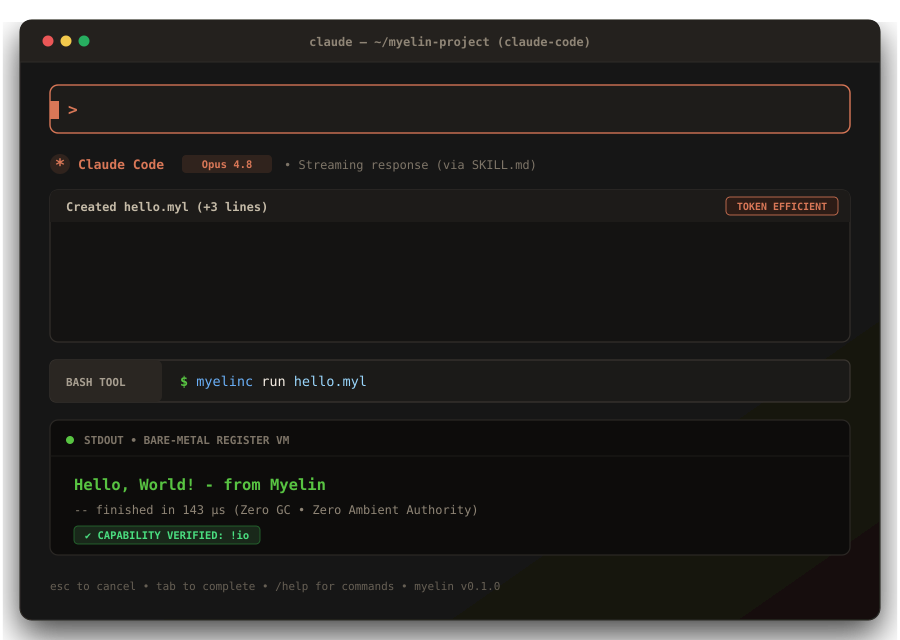

<div align="center">

# Myelin (`.myl`)

**Yapay Zekâ Çağı İçin Evrensel, Token-Optimal, Yetki-Güvenlikli Sistem Programlama Dili.**

[](https://github.com/muscankaraoglu/myelin-lang/actions)
[](./LICENSE)
[](https://github.com/muscankaraoglu/myelin-lang/releases)
[](https://muscankaraoglu.github.io/myelin-lang/)

<br />

<p align="center">
  
</p>

[English](./README.md) • [Türkçe Dokümantasyon](./README.tr.md) • [Resmi Dokümantasyon Merkezi (Wiki)](./wiki/) • [LLM Yetenek Belgesi (SKILL.md)](./SKILL.md)

</div>

---

## ⚡ Temel Vizyon

Nörobiyolojide **miyelin (myelin)**, sinir aksonlarını sararak sinyal kaçağını önleyen ve iletim hızını 100 kat artıran kılıftır. Yazılım mühendisliğinde **Myelin**, yapay zekâ düşüncesi ile makine sinyalleri arasındaki on yıllardır süregelen insan odaklı gereksiz sözdizimi yükünü ortadan kaldırır.

Klasik diller (C#, TypeScript, Python, Rust) insanların biyolojik sınırlarına göre tasarlandı: dakikada 60 kelime yazabilen parmaklar, görsel süslü parantez eşleştirme ve `async/await` karmaşası.

Otonom kodlama ajanları yazılım geliştirdiğinde bu insan alışkanlıkları büyük bir yüke dönüşür:
1. **%55–65 Çıktı Token İsrafı:** Seremoni anahtar kelimeleri ve kapanış parantezleri context pencerelerini hızla tüketir.
2. **Gizli Yan Etki Hataları:** `null`, kontrolsüz istisnalar ve gizli sistem yetkileri üretilen binlerce satır kodun arkasına saklanır.
3. **İnsan İnceleme Darboğazı:** Eğer kodu yapay zeka yazıyorsa, insanlar o koda *nasıl güvenecek?*

**Myelin Sözleşmesi:**
- **LLM'ler [`SKILL.md`](./SKILL.md)'yi okur** (~900 token) ve tek bir süslü parantez olmadan **Düz Satır-SSA** kodunu üretir.
- **Makineler `.myl` kodunu mikrosaniyeler içinde derler**; **Perceus otomatik bellek modeli** sayesinde sıfır GC duraksaması ve C/Rust hızı elde eder.
- **İnsanlar `myelinc audit` çalıştırır**; kodu satır satır okumak yerine kriptografik **Güven ve Yetki Karnesini** (`!fs`, `!net`, `!db`, sözleşmeler ve SHA-256) doğrular.

---

## 🚀 60 Saniyede Hızlı Başlangıç

### 1. Hazır Derleyiciyi İndirin (`myelinc`)

Sıfır dış bağımlılıkla çalışan tek-dosya derleyici ikilileri [GitHub Releases](https://github.com/muscankaraoglu/myelin-lang/releases) sayfasında hazırdır:

| İşletim Sistemi | Mimari | Paket |
| :--- | :--- | :--- |
| **Windows** | x86_64 | [`myelinc-windows-x86_64.zip`](https://github.com/muscankaraoglu/myelin-lang/releases) |
| **Linux** | x86_64 | [`myelinc-linux-x86_64.tar.gz`](https://github.com/muscankaraoglu/myelin-lang/releases) |
| **Linux (ARM64)** | aarch64 | [`myelinc-linux-arm64.tar.gz`](https://github.com/muscankaraoglu/myelin-lang/releases) |
| **macOS (Apple Silicon)** | M1/M2/M3/M4 (arm64) | [`myelinc-macos-arm64.tar.gz`](https://github.com/muscankaraoglu/myelin-lang/releases) |
| **macOS (Intel)** | x86_64 | [`myelinc-macos-x86_64.tar.gz`](https://github.com/muscankaraoglu/myelin-lang/releases) |

---

### 2. İlk Programınızı Yazın (`hello.myl`)

```text
#mod main

#fn main [] !io
  io.println "Hello, World! - from Myelin"
```

### 3. Çalıştırın

```bash
# Windows
.\myelinc.exe run hello.myl

# Linux / macOS
./myelinc run hello.myl
```

Çıktı:
```text
Hello, World! - from Myelin
-- finished in 143 µs
```

---

## 📄 Lisans

Myelin, dilediğiniz seçeneğe göre **çift lisans (Dual License)** altındadır:
- **MIT License** ([`LICENSE`](./LICENSE))
- **Apache License, Version 2.0**
