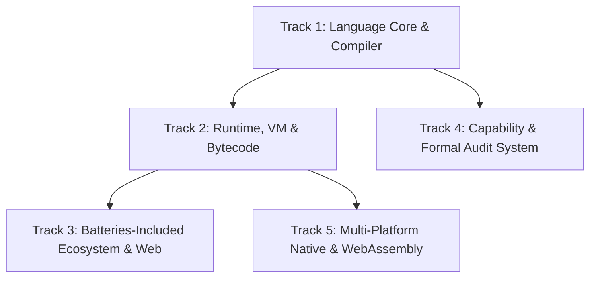

# Myelin (`.myl`) Master Roadmap (v1.0 to v2.0)

> **Vision:** The first universal, capability-safe, zero-GC systems language designed specifically for autonomous LLM authorship, bare-metal execution, and human trust verification without manual code auditing.

---

## Architecture Tracks & Workstreams

---

## Detailed Roadmap Phases

### Phase 1: Core Language & Type System (Status: Completed ✅)
- [x] Zero-copy single-pass indentation lexer (`myelin-lexer`)
- [x] LL(1) + Pratt AST parser (`myelin-ast`, `myelin-parser`)
- [x] Single-line `--llm` diagnostic protocol (`myelin-diag`)
- [x] Standalone zero-dependency executable (`myelinc.exe`)

### Phase 2: Static Verification & Capability Security (Status: In Progress 🟡)
- [ ] Static type checker (`myelin-check`) for primitives, `?T` (Option), `T!E` (Result)
- [ ] Capability lattice checker: enforce `!net`, `!db`, `!fs`, `!io`, `!unsafe.mem`
- [ ] Contract enforcement: compile-time validation for `req` (precondition) and `ens` (postcondition)
- [ ] Trust Manifest CLI: `myelinc audit <file.myl>` generating human-verifiable security summaries

### Phase 3: The 64-bit Register Virtual Machine (`myelin-vm`)
- [ ] Flat Line-SSA lowering (`myelin-mir`)
- [ ] Perceus static reference counting: compiler-injected zero-GC memory reuse
- [ ] Register-based bytecode VM for sub-millisecond execution and inline `#test` verification
- [ ] Fiber-based colorless concurrency (automatic suspension on `!net` / `!io` calls)

### Phase 4: Production Standard Library & Multi-Model Web/DB
- [x] Embedded key-value & document storage (`db.set`, `db.get`, `db.has`)
- [x] Native high-concurrency HTTP/REST server (`http.serve`)
- [ ] JSON & Binary serialization primitives (`json.parse`, `json.stringify`)
- [ ] File system module (`fs.read_str`, `fs.write_str`, `fs.list`) with `!fs` permission
- [ ] Crypto & Hashing module (`crypto.sha256`, `crypto.random`)

### Phase 5: Multi-Platform Codegen (WASM, Linux, Windows, macOS, Bare-Metal)
- [ ] Cranelift JIT / AOT backend for native machine code (`x86_64`, `AArch64`)
- [ ] WebAssembly (WASM) backend for running Myelin modules in the browser and edge workers
- [ ] C ABI FFI (`#ext "c"`) for seamless interop with existing operating system APIs

---

## Subagent Roles & Responsibilities

1. **`myelin-core-engineer`**: Focuses on `myelin-parser`, AST extensions, and type checking (`myelin-check`).
2. **`myelin-vm-engineer`**: Focuses on bytecode format, registers, SSA lowering, and the high-speed virtual machine.
3. **`myelin-stdlib-engineer`**: Expands web features, HTTP routers, database adapters, JSON, and I/O.
4. **`myelin-qa-benchmarker`**: Writes extensive `.myl` test suites, verifies LLM token consumption vs Rust/C#, and maintains benchmark suites.
