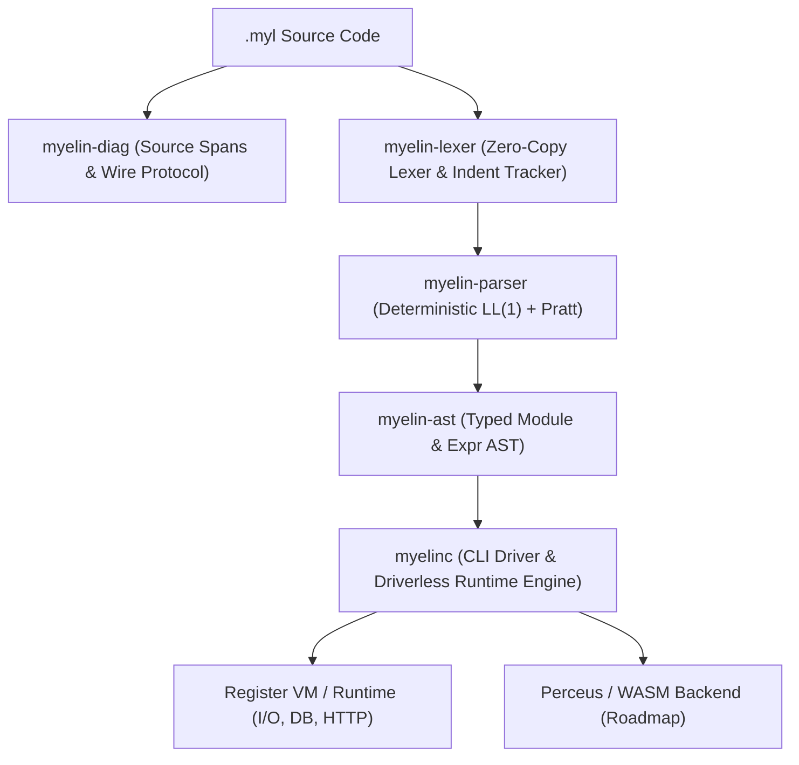

# Compiler Architecture & Crates

Myelin is architected as a modular Rust workspace consisting of specialized, high-performance crates.

---

## Workspace Crates

| Crate | Path | Responsibility |
| :--- | :--- | :--- |
| **`myelin-diag`** | `crates/myelin-diag` | Byte and line-column source span mapping, error code enum (`E001` - `E050`), and the single-line `--llm` diagnostic wire emitter. |
| **`myelin-ast`** | `crates/myelin-ast` | Typed Abstract Syntax Tree definitions for modules, items, records, sums, functions, contracts, statements, and Pratt expressions. |
| **`myelin-lexer`** | `crates/myelin-lexer` | Single-pass zero-copy scanner that validates 2-space indentation, rejects tabs (`E001`), and emits synthetic `INDENT`/`DEDENT` tokens. |
| **`myelin-parser`** | `crates/myelin-parser` | Deterministic recursive-descent LL(1) parser for top-level `#` items paired with a Pratt parser for binary and unary expressions. |
| **`myelinc`** | `crates/myelinc` | Unified command-line interface (`run`, `check`, `parse`, `lex`), diagnostic reporting, and driverless execution runtime (I/O, Key-Value DB, Native HTTP). |

---

## Extending the Language

Adding a new built-in feature or module is straightforward:

1. **AST / Grammar Update:** If new syntax is needed, update `myelin-ast` and `myelin-parser`.
2. **Lexer Verification:** Ensure tokenization maintains 2-space indentation invariants in `myelin-lexer`.
3. **Runtime Builtins:** To add a new standard library function (e.g. `crypto.sha256` or `fs.read_file`), implement the capability check and evaluation handler in `crates/myelinc/src/main.rs`.
4. **LLM Skill Update:** Keep `SKILL.md` aligned with any new standard module syntax.

---

## Roadmap

- [x] LL(1) Indentation Lexer & Pratt Parser
- [x] Single-line LLM Diagnostic Protocol (`--llm`)
- [x] Design-by-Contract (`req` / `ens`) and Capability Safety (`!`)
- [x] Embedded Key-Value Storage (`db.set`, `db.get`, `db.has`)
- [x] Native Multi-threaded HTTP Server (`http.serve`)
- [ ] 64-bit Register VM Bytecode Generator
- [ ] Perceus Compile-Time Reference Counting & Reuse Analysis
- [ ] Cranelift / LLVM Bare-Metal JIT & WASM Compilation Backend
- [ ] LSP (Language Server Protocol) for VS Code & JetBrains
