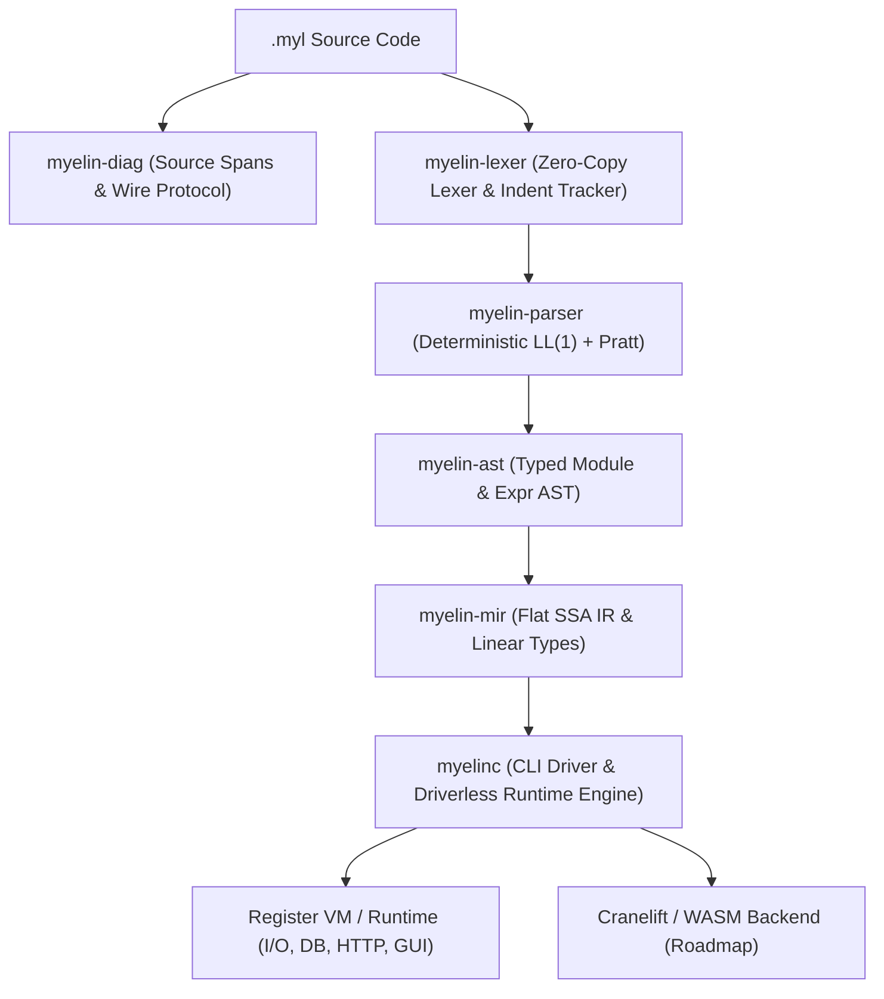

# Compiler Architecture & Crates

Myelin is architected as a modular Rust workspace consisting of specialized, high-performance crates.

---

## Workspace Crates

| Crate | Path | Responsibility |
| :--- | :--- | :--- |
| **`myelin-diag`** | `crates/myelin-diag` | Byte and line-column source span mapping, error code enum (`E001` - `E050`), and the single-line `--llm` diagnostic wire emitter. |
| **`myelin-ast`** | `crates/myelin-ast` | Typed Abstract Syntax Tree definitions for modules, items, records, sums, functions, contracts, statements, and Pratt expressions. |
| **`myelin-lexer`** | `crates/myelin-lexer` | Single-pass zero-copy scanner that validates 2-space indentation, rejects tabs (`E001`), and emits synthetic `INDENT`/`DEDENT` tokens. |
| **`myelin-parser`** | `crates/myelin-parser` | Deterministic recursive-descent LL(1) parser for top-level `#` items paired with a Pratt parser for binary and unary expressions. |
| **`myelin-mir`** | `crates/myelin-mir` | Flat Single Static Assignment (SSA) intermediate representation, basic block argument CFG lowering, and Austral-style linear type resource checking (`L001`, `L002`). |
| **`myelinc`** | `crates/myelinc` | Unified command-line interface (`run`, `check`, `audit`, `mir`, `parse`, `lex`), cryptographic SHA-256 trust manifest engine (`audit.rs`), diagnostic reporting, and driverless execution runtime (I/O, Key-Value DB, Native HTTP, ANSI Terminal, CLI Flags, Native Win32 GUI). |

---

## Extending the Language

1. **AST / Grammar Update:** If new syntax is needed, update `myelin-ast` and `myelin-parser`.
2. **Lexer Verification:** Ensure tokenization maintains 2-space indentation invariants in `myelin-lexer`.
3. **MIR Lowering:** Lower new statements/expressions to SSA virtual registers in `crates/myelin-mir`.
4. **Runtime Builtins:** To add a new standard library function (e.g. `json.parse` or `gui.window`), implement the evaluation handler in `crates/myelinc/src/main.rs`.
5. **Audit Engine:** Ensure the capability collector in `crates/myelinc/src/audit.rs` tracks new builtin symbols and maps them to the appropriate capability requirement.
6. **LLM Skill Update:** Keep `SKILL.md` aligned with any new standard module syntax.

---

## Roadmap

- [x] LL(1) Indentation Lexer & Pratt Parser
- [x] Single-line LLM Diagnostic Protocol (`--llm`)
- [x] Design-by-Contract (`req` / `ens`) and Capability Safety (`!`)
- [x] Embedded Key-Value Storage (`db.set`, `db.get`, `db.has`)
- [x] Native Multi-threaded HTTP Server (`http.serve`)
- [x] Terminal Color & Styling Engine (`term.*`)
- [x] Command-Line Argument & Flag Parser (`cli.*`)
- [x] Dynamic JSON Parser & Serializer (`json.*`)
- [x] Native Lightweight Desktop GUI (`gui.*`)
- [x] Flat SSA Intermediate Representation & Basic Block CFG (`myelin-mir`)
- [x] Linear Types Resource Calculus & Leak Verification (`L001`, `L002`)
- [x] Cryptographic Human Trust Manifest & Capability Verifier (`myelinc audit`)
- [ ] Perceus Compile-Time Reference Counting & Reuse Analysis
- [ ] Cranelift / LLVM Bare-Metal JIT & WASM Compilation Backend
- [ ] On-device AI inference (`std.ai`)
- [ ] LSP (Language Server Protocol) for VS Code & JetBrains
