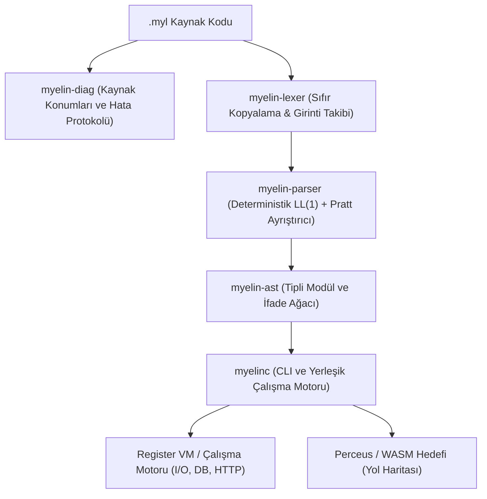

# Derleyici Mimarisi ve Crate Yapısı

Myelin, birbirine gevşek bağlı (loosely coupled) ve yüksek performanslı Rust crate'lerinden oluşan modüler bir çalışma alanıdır (workspace).

---

## Çalışma Alanı Crate'leri

| Crate | Dizin | Görev ve Sorumluluklar |
| :--- | :--- | :--- |
| **`myelin-diag`** | `crates/myelin-diag` | Bayt ve satır-sütun haritalama, hata kodları (`E001` - `E050`) ve tek satırlık `--llm` protokol çıktılayıcısı. |
| **`myelin-ast`** | `crates/myelin-ast` | Modül, öğe, kayıt (record), toplam (sum), fonksiyon, sözleşme ve ifadeler için tipli Soyut Sözdizim Ağacı. |
| **`myelin-lexer`** | `crates/myelin-lexer` | 2-boşluk girinti kuralını denetleyen, tab karakterlerini reddeden (`E001`) ve `INDENT`/`DEDENT` tokenları üreten tek geçişli sıfır kopyalama tarayıcısı. |
| **`myelin-parser`** | `crates/myelin-parser` | Üst seviye `#` öğeleri için deterministik özyineli iniş (LL(1)) ve ifadeler için Pratt algoritmasını kullanan ayrıştırıcı. |
| **`myelinc`** | `crates/myelinc` | Birleşik komut satırı arayüzü (`run`, `check`, `audit`, `parse`, `lex`), kriptografik SHA-256 güven manifestosu motoru (`audit.rs`), hata raporlama ve sürücüsüz yerleşik çalışma motoru (I/O, Anahtar-Değer DB, Yerel HTTP Sunucusu, ANSI Terminal Renkleri, CLI Bayrakları). |

---

## Yeni Bir Özellik Eklemek

Geliştiriciler yeni bir yerleşik modül veya özellik eklemek istediklerinde şu adımları izler:

1. **AST ve Dilbilgisi:** Yeni bir sözdizimi gerekiyorsa `myelin-ast` ve `myelin-parser` güncellenir.
2. **Lexer Doğrulaması:** Yeni simgelerin veya anahtar sözcüklerin 2-boşluk kuralıyla çelişmediği `myelin-lexer` testleriyle doğrulanır.
3. **Çalışma Zamanı:** Yeni standart kütüphane fonksiyonu (örneğin `term.green` veya `cli.args`), `crates/myelinc/src/main.rs` içinde yetenek denetimi yapılarak uygulanır.
4. **Denetim Motoru (Audit Engine):** Yeni sembollerin `crates/myelinc/src/audit.rs` içerisindeki yetenek toplayıcısına tanıtıldığından ve doğru yetenekle eşleştiğinden emin olunur.
5. **LLM Becerisi:** Yapay zeka ajanlarının yeni özelliği doğru kullanabilmesi için `SKILL.md` güncellenir.

---

## Yol Haritası (Roadmap)

- [x] LL(1) Girinti Takip Eden Lexer ve Pratt Ayrıştırıcı
- [x] Tek Satırlık LLM Teşhis ve Onarım Protokolü (`--llm`)
- [x] Sözleşmeli Tasarım (`req` / `ens`) ve Yetenek Güvenliği (`!`)
- [x] Dahili Anahtar-Değer Veritabanı (`db.set`, `db.get`, `db.has`)
- [x] Çok İş Parçacıklı Yerel HTTP Sunucusu (`http.serve`)
- [x] ANSI Terminal Renklendirme Motoru (`term.*`)
- [x] Komut Satırı Argüman ve Bayrak Çözümleyici (`cli.*`)
- [x] Kriptografik İnsan Güven Manifestosu ve Yetenek Denetleyicisi (`myelinc audit`)
- [ ] 64-bit Register Tabanlı Sanal Makine (Register VM)
- [ ] Perceus Derleme Zamanı Referans Sayımı ve Yeniden Kullanım Analizi
- [ ] Cranelift / LLVM Doğrudan Makine Kodu ve WASM Derleme Arka Yüzü
- [ ] VS Code ve JetBrains İçin Dil Sunucusu (LSP)
